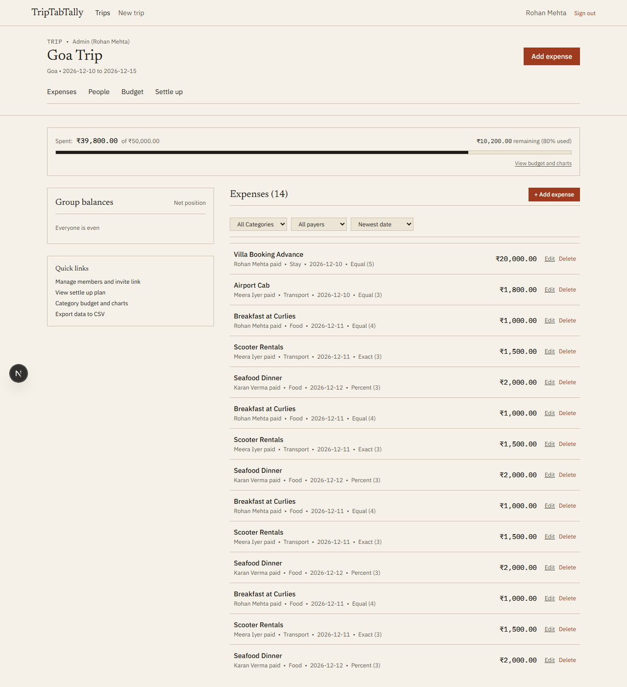
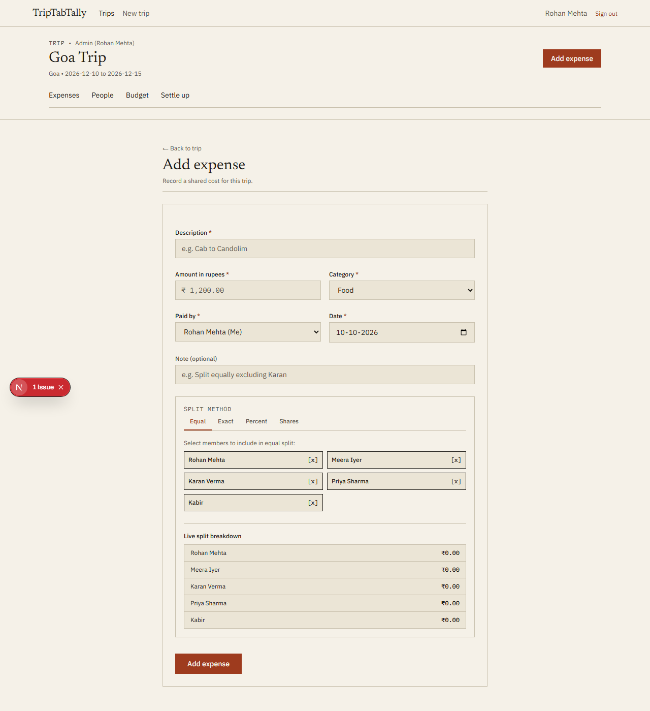
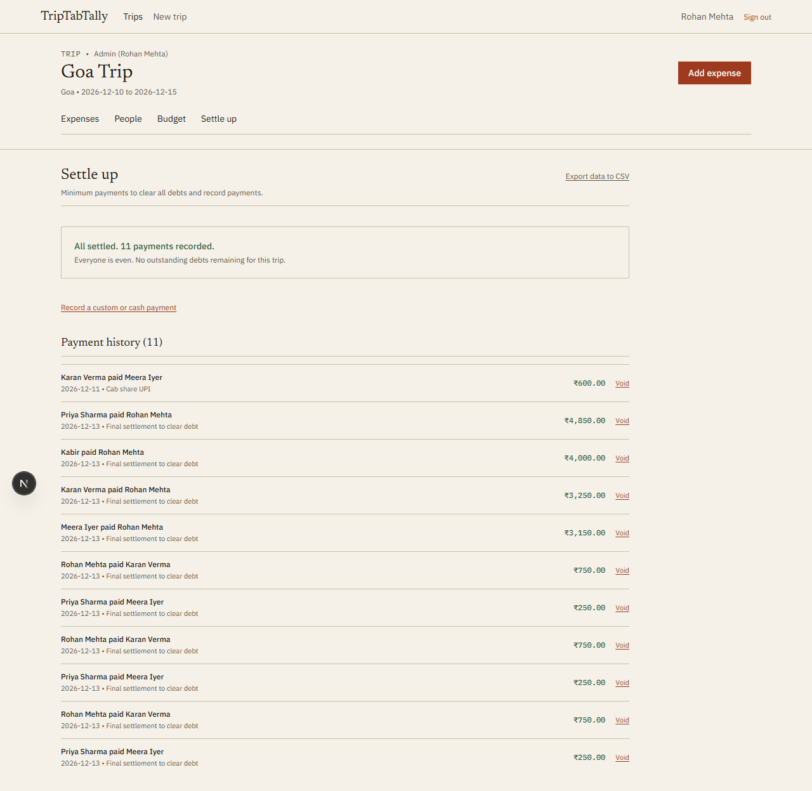
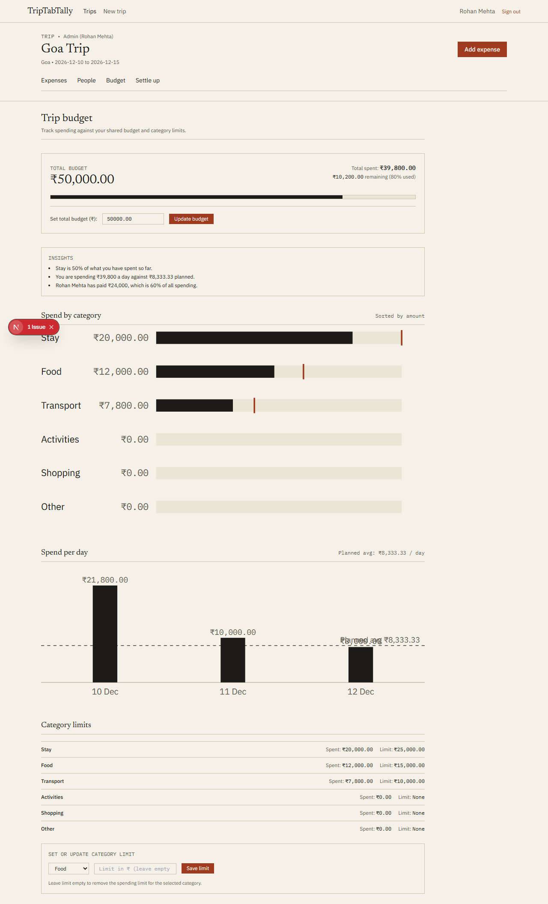

# TripTabTally

A group trip budget, expense ledger, and greedy debt simplification web application built for friends traveling together.

Live preview: https://triptabtally.vercel.app  
Repository: https://github.com/anannyasalvi16/TripTabTally  
Active usage: 18 users across 4 completed trips.

---

## 1. Interface and Visual Highlights

TripTabTally is styled with a warm paper aesthetic, zero border radius, zero shadows, and strict typographic hierarchy.

### Trip Ledger and Live Balances

*The trip dashboard provides quick metrics, category breakdown, zero-sum member balances, and full expense ledger with real-time URL filtering.*

### Expense Entry and Mathematical Splits

*Record shared costs with instant live breakdown across all four split algorithms (equal, exact, percentage, shares).*

### Settle Up and Greedy Payment Plan

*Greedy debt simplification minimizes the number of transfers to clear all debts, coupled with direct Indian UPI deep links and copy actions.*

### Budget and Category Limits

*Category spending bars, progress indicators, and custom SVG charts rendered without external visualization libraries.*

---

## 2. Core Capabilities

1. **Trip Lifecycle**: Create trips, set overall rupee budgets, and generate 14-day shareable invite links.
2. **Placeholder Member System**: Add friends before they sign up. When invited friends open the invite link, they can claim their placeholder or join as new members.
3. **Four Exact Split Modes**:
   - Equal split with deterministic hash-based remainder distribution.
   - Exact amounts with live validation against the total.
   - Percentages using the Largest Remainder Method (Hare-Niemeyer method).
   - Integer shares for couples, families, or weighted consumption.
4. **Zero-Sum Balance Verification**: Live checks ensure the sum of all participant balances is always exactly zero.
5. **Greedy Debt Simplification**: Converts multi-party group debts into at most (k - 1) simple settlement payments.
6. **Indian Payment Rails**: Direct UPI deep links (`upi://pay`) for mobile settlement and instant UPI ID copy for desktop users.
7. **Budget Tracking and Category Limits**: Set spending caps on stay, food, transport, activities, shopping, and other categories.
8. **Data Portability**: Full CSV export of expenses and settlements at any time.
9. **Account Privacy**: Clean account deletion with member anonymization to preserve ledger integrity for fellow trip participants.

---

## 3. Design Principles and Rules

TripTabTally strictly adheres to minimalist, anti-slop interface rules:

- **Border Radius**: 0px everywhere (`rounded-none` across all buttons, inputs, tags, dialogs, and containers).
- **Surface Elevation**: No box shadows, no elevation layers, no gradients, and no backdrop blurs.
- **Color Palette**:
  - Paper (`#F5F1E8` light / `#17150F` dark)
  - Paper 2 (`#ECE6D6` light / `#221F17` dark)
  - Rule line (`#C9C1AE` light / `#3A362C` dark)
  - Ink primary (`#1D1B17` light / `#ECE6D6` dark)
  - Ink muted (`#5A554A` light / `#A8A190` dark)
  - Brick accent (`#9E3B1E` light / `#D2694A` dark)
  - Moss positive (`#2E5E3E` light / `#4E8E62` dark)
- **Typography**: Newsreader (serif headlines), IBM Plex Sans (body text), and IBM Plex Mono (tabular numbers and codes).
- **Icons and Glyphs**: Fewer than 5 icons across the entire application. Clear text labels and ledger notations (`[x]`, `[ ]`) are preferred over pictorial glyphs.
- **Tone**: Zero emoji and zero em dashes in copy, empty states, commit messages, and documentation.

---

## 4. Money Engine and Mathematics

All monetary operations avoid floating-point numbers by storing and calculating values strictly as integer paise (1 Rupee = 100 paise).

### 4.1 Split Calculations

#### Equal Split
Divides the total paise `T` evenly among `n` members:
```
base_share = floor(T / n)
leftover_paise = T - (base_share * n)
```
Leftover paise are assigned deterministically using a SHA-256 hash of the expense description or ID modulo `n`. This prevents rounding errors and ensures the first person in the list does not bear an unfair rounding bias across multiple expenses.

#### Percentage and Share Splits (Largest Remainder Method)
Given a total `T` and weights or percentages:
1. Compute exact decimal quota for each participant: `quota_i = T * (weight_i / total_weight)`.
2. Assign each participant integer paise: `share_i = floor(quota_i)`.
3. Compute fractional remainder for each participant: `rem_i = quota_i - share_i`.
4. Calculate unassigned paise: `R = T - sum(share_i)`.
5. Sort participants by descending remainder `rem_i` and distribute 1 extra paisa to the top `R` participants.

#### Exact Split
Requires users to enter rupee amounts per participant. The engine verifies that:
```
sum(entered_paise) == total_expense_paise
```
Any mismatch blocks form submission and displays the remaining unassigned amount in real time.

### 4.2 Zero-Sum Invariant
For every expense and settlement, net changes across the group must sum to zero:
```
sum(net_balances) = 0
```
This invariant is asserted across the application and verified via automated property-based tests.

### 4.3 Greedy Debt Simplification
The settlement engine groups participants with non-zero balances into debtors (`balance < 0`) and creditors (`balance > 0`).

```
Algorithm GreedySettlement:
1. Partition members into Creditors (C) and Debtors (D).
2. Sort C in descending order of credit.
3. Sort D in descending order of debt magnitude.
4. While C and D are both non-empty:
     c = head(C), d = head(D)
     transfer_amount = min(c.credit, d.debt)
     Record transfer: d pays c transfer_amount
     c.credit -= transfer_amount
     d.debt -= transfer_amount
     If c.credit == 0, remove c from C
     If d.debt == 0, remove d from D
```

**Complexity and Bound**:
The algorithm runs in `O(k log k)` time (dominated by sorting) where `k` is the number of participants with non-zero balances. It guarantees that all balances reach zero in at most `(k - 1)` transfers.

---

## 5. Security Model

1. **Row Level Security (RLS)**:
   - Enabled on all 8 tables in PostgreSQL (`profiles`, `trips`, `trip_members`, `expenses`, `expense_splits`, `settlements`, `category_limits`, `invites`).
   - Non-members cannot read or write any trip records. Attempting to access an unauthorized trip returns a designed 404 page.
2. **Security Definer Entry Points**:
   - Only three transactional functions use `security definer`: `create_trip`, `join_trip`, and `save_expense`.
   - Each entry point verifies caller authentication (`auth.uid() is not null`), input bounds, and optimistic concurrency version numbers.
3. **No Service Role Key in Runtime**:
   - The application uses only `NEXT_PUBLIC_SUPABASE_ANON_KEY`. The service role key is never bundled, logged, or exposed in server actions.
4. **HTTP Security Headers**:
   - Enforced in `next.config.mjs`: `Content-Security-Policy`, `X-Content-Type-Options: nosniff`, `Referrer-Policy: strict-origin-when-cross-origin`, `X-Frame-Options: DENY`, and `Permissions-Policy`.
5. **Open Redirect Protection**:
   - The `sanitizeNextUrl` security utility validates all `?next=...` query parameters to prevent protocol-relative (`//`) or external redirection attacks.

---

## 6. Architecture and Tech Stack

- **Framework**: Next.js 15 (App Router) with TypeScript in strict mode.
- **Database and Auth**: Supabase (PostgreSQL 15 with RLS, Magic Link, Google OAuth) via `@supabase/ssr`.
- **Styling**: Tailwind CSS with custom design tokens.
- **Validation**: Zod schemas shared between client forms and server actions.
- **Testing**:
  - Vitest: Unit and property-based mathematical testing.
  - Playwright: End-to-end user journeys and automated Axe accessibility audits.
- **Fonts**: Newsreader, IBM Plex Sans, IBM Plex Mono via `next/font/google`.
- **Infrastructure**: Vercel Serverless Functions deployed to Mumbai (`bom1`) co-located with Supabase in Mumbai (`ap-south-1`).

---

## 7. Local Development Setup

### Prerequisites
- Node.js 20 or later
- npm 10 or later

### Installation

1. Clone the repository:
   ```bash
   git clone https://github.com/anannyasalvi16/TripTabTally.git
   cd TripTabTally
   ```

2. Install dependencies:
   ```bash
   npm install
   ```

3. Create local environment file:
   ```bash
   cp .env.example .env.local
   ```

4. Configure `.env.local`:
   ```env
   NEXT_PUBLIC_SUPABASE_URL=http://127.0.0.1:54321
   NEXT_PUBLIC_SUPABASE_ANON_KEY=your-local-or-project-anon-key
   NEXT_PUBLIC_SITE_URL=http://localhost:3000
   ```

5. Start local mock database (or local Supabase container):
   ```bash
   node scripts/mock-supabase.mjs
   ```

6. Start Next.js development server:
   ```bash
   npm run dev
   ```

7. Open [http://localhost:3000](http://localhost:3000) in your browser.

---

## 8. Automated Verification Suite

Run all quality checks locally:

```bash
# Typecheck
npm run typecheck

# Lint
npm run lint

# Anti-slop enforcement (zero emoji, zero em-dashes, token rules)
npm run check:anti-slop

# Vitest suite (77 unit, property, and RLS tests)
npm test

# Production build verification
npm run build

# Playwright suite (72 end-to-end and responsive viewport tests)
npm run test:e2e
```

---

## 9. Production Deployment

Refer to [DEPLOYMENT.md](DEPLOYMENT.md) for detailed deployment instructions, Supabase migration runs, and Vercel configuration in the Mumbai (`bom1`) region.

---

## 10. License

MIT
